# tvOS Launcher PL · 2.1.5-pl30

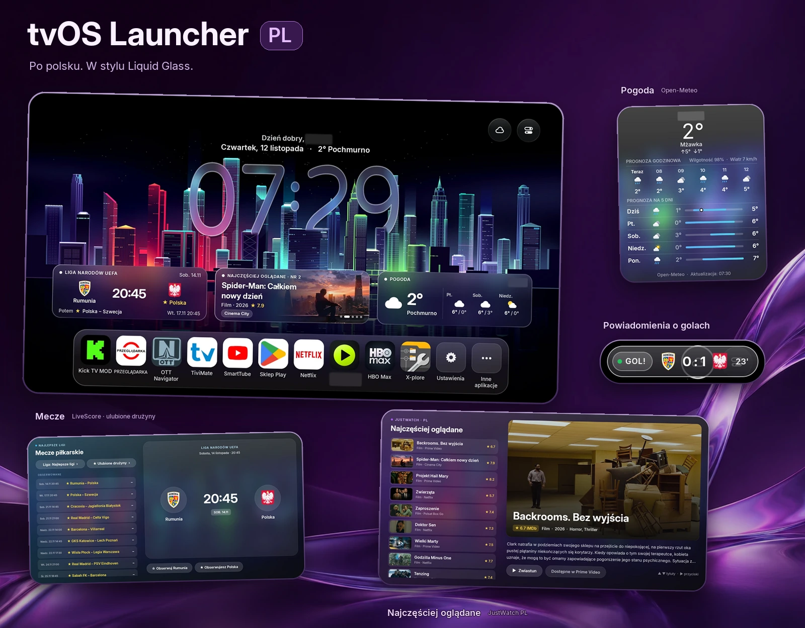

[Galeria sześciu widoków / Six-screen gallery](zrzuty-github/gotowe/preview.webp) · [Drugi wariant planszy / Alternative cover](zrzuty-github/gotowe/showcase-immersive.webp)

## Polski

Polska wersja [tvOS Launcher autorstwa techgenius1](https://github.com/techgenius1/tvOS-Launcher). Opis samego launchera i jego pozostałych funkcji znajdziesz w oryginalnym repozytorium; tutaj pokazujemy zmiany moda PL.

### Co zmieniono

| Zmiana | Zrzut — kliknij, aby powiększyć |
| --- | --- |
| **Pełne spolszczenie.** Interfejs, kreator pierwszego uruchomienia i opisy pogody są po polsku. | [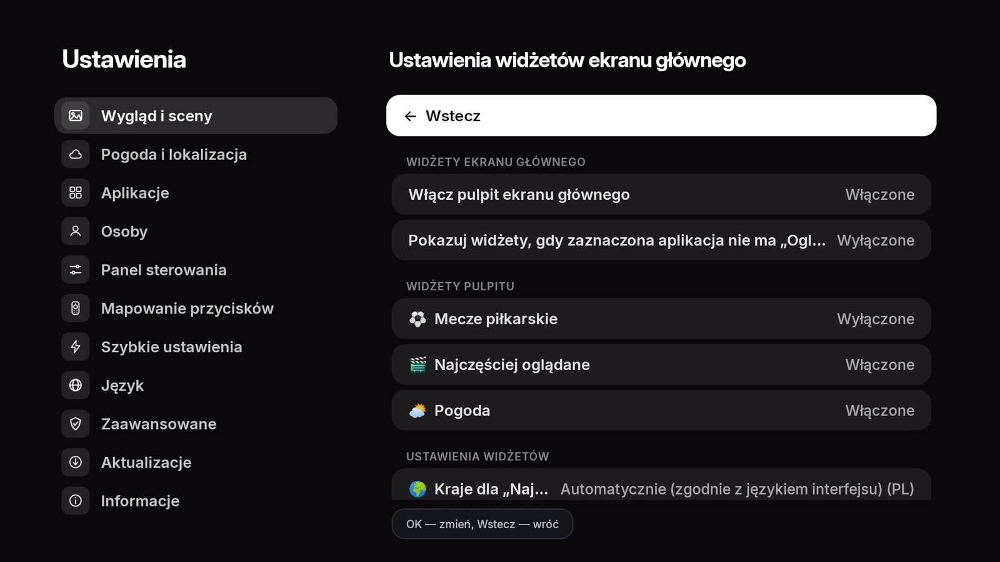](zrzuty-github/gotowe/widget-settings.webp) |
| **Kafelki i okna Liquid Glass: mecze.** Kafelek pokazuje najbliższy mecz, a podczas spotkania wynik na żywo z LiveScore; osobne okno pozwala przeglądać mecze i obserwować drużyny. | [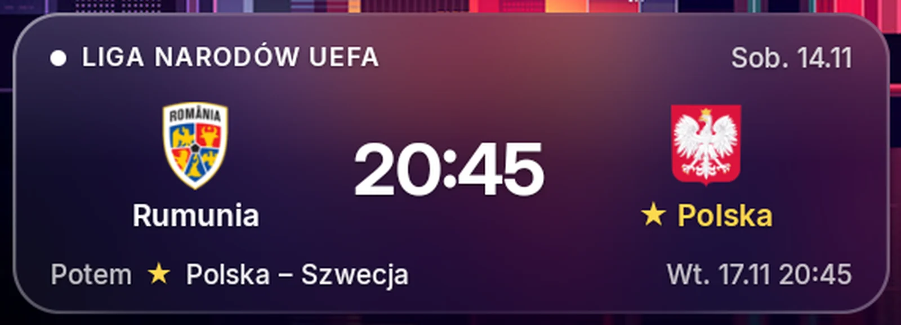](zrzuty-github/gotowe/matches-tile.webp) [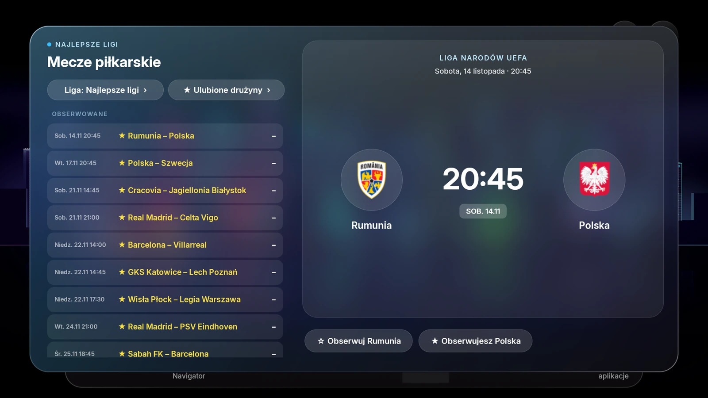](zrzuty-github/gotowe/matches.webp) |
| **„Najczęściej oglądane”.** Szklany kafelek i okno z popularnymi filmami i serialami z JustWatch dla Polski, opisami oraz przejściem do dostępnych serwisów. | [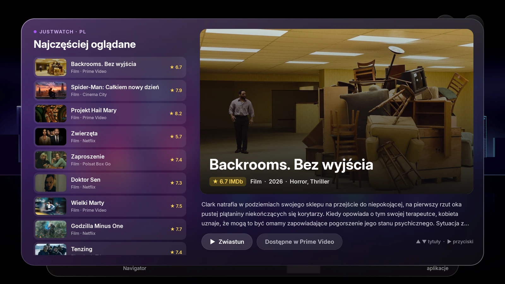](zrzuty-github/gotowe/most-watched.webp) |
| **Pogoda.** Kafelek Liquid Glass otwiera polską prognozę godzinową i na kolejne dni. | [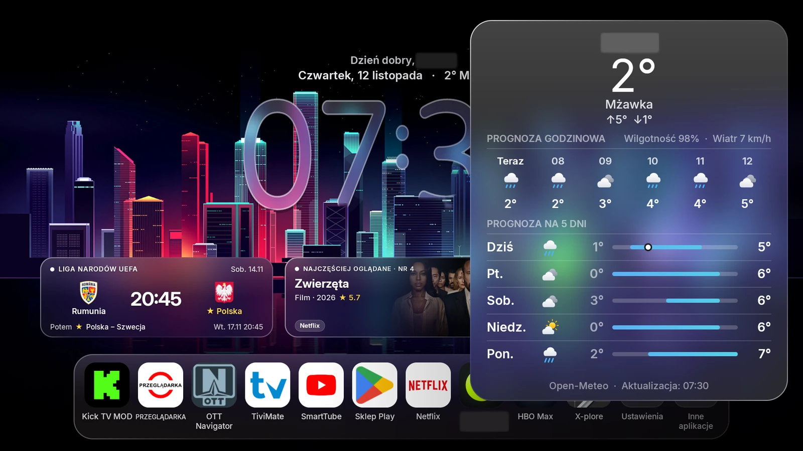](zrzuty-github/gotowe/weather.webp) |
| **Powiadomienia o golach.** Plakietki z herbami i wynikiem ulubionych drużyn mogą pojawiać się także nad innymi aplikacjami, po nadaniu zgody. Zrzut pokazuje powiadomienie przykładowe. | [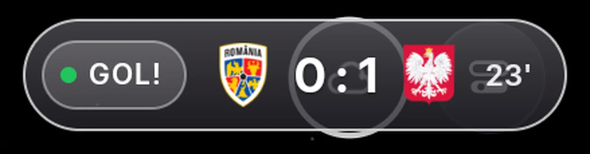](zrzuty-github/gotowe/goal-badge.webp) |
| **„Oglądaj dalej” przez lokalne ADB.** Uprawnienie do informacji o odtwarzaniu można włączyć z launchera, potwierdzając zgodę na telewizorze. Obok: ekran wyboru sposobu nadawania uprawnień. | [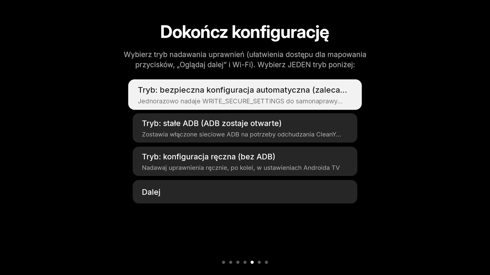](zrzuty-github/gotowe/setup-mode.webp) |
| **Nocne tapety z internetu.** Supercary i auta po tuningu — m.in. Audi RS, Mercedes-AMG i Lamborghini — w nocy i neonach oraz futurystyczne miasta nocą; zdjęcia za dnia launcher pomija. | [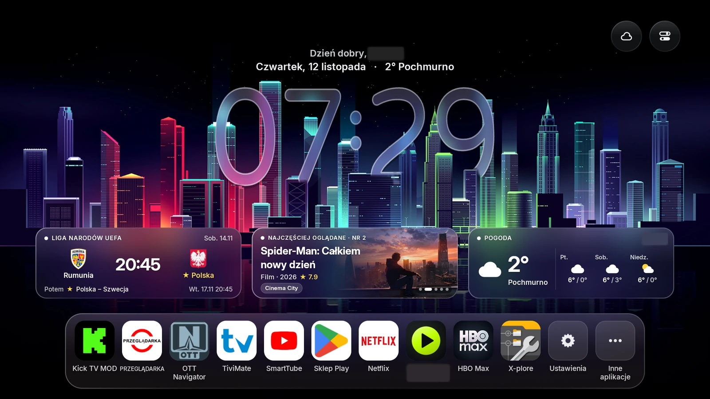](zrzuty-github/gotowe/home.webp) |
| **Zegar dopasowany do zdjęcia.** Dół szklanych cyfr chowa się za dachem auta lub budynkami, a wykrywacz aut TensorFlow Lite działający w telewizorze pomaga unikać ustawiania zegara na aucie. Cyfry zachowują szklany wygląd scen oryginału. | [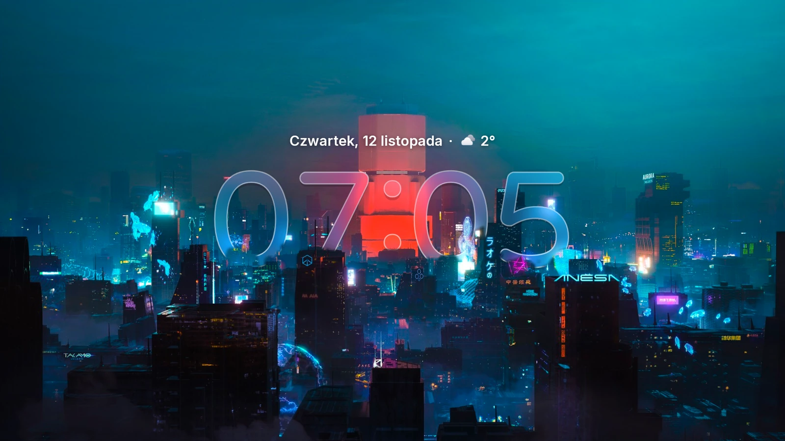](zrzuty-github/gotowe/screensaver-1.webp) |
| **Ulubione tapety.** Zapisane zdjęcia wracają domyślnie co piątą zmianę tapety; częstotliwość można zmienić. | [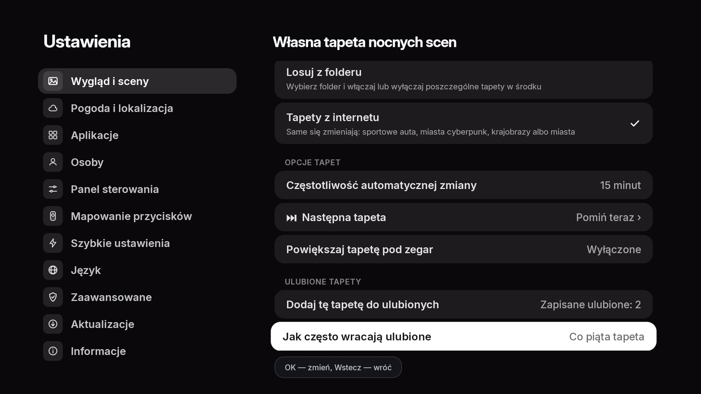](zrzuty-github/gotowe/wallpaper-settings.webp) |
| **Wygaszacz ekranu.** Korzysta z tych samych zdjęć i tego samego szklanego zegara co ekran główny. |  |
| **Kreator zachowuje debugowanie USB.** Zalecany tryb konfiguracji nie wyłącza debugowania USB. |  |

### Instalacja

1. Pobierz APK z sekcji [Releases tego forka](https://github.com/premiumsmart/tvOS-Launcher-PL/releases) i przenieś na Android TV / Google TV pendrive'em lub przez Send files to TV.
2. Otwórz plik w menedżerze plików; jeśli trzeba, zezwól temu menedżerowi na instalację z nieznanych źródeł.
3. Przejdź polski kreator: profil, sceny i miasto do pogody. Wybierz konfigurację ręczną, jeśli chcesz samodzielnie nadawać uprawnienia; wyłączanie systemowych launcherów i CleanYourTV są opcjonalne.
4. Jeśli system zapyta o domyślny ekran główny, wybierz tvOS Launcher; w przeciwnym razie uruchamiaj go z listy aplikacji.

„Oglądaj dalej”: włącz debugowanie USB w opcjach programisty telewizora, następnie **Ustawienia launchera → Szybkie ustawienia → Uprawnienie „Oglądaj dalej” → Włącz** i potwierdź pytanie telewizora. Po nadaniu uprawnienia możesz wyłączyć debugowanie USB. Aktualizacja istniejącej instalacji wymaga tego samego klucza podpisu.

### Dane i licencja

Mecze: [LiveScore](https://www.livescore.com/), pomocniczo [TheSportsDB](https://www.thesportsdb.com/); popularne tytuły: [JustWatch Polska](https://www.justwatch.com/pl); pogoda: [Open-Meteo](https://open-meteo.com/); tapety: [Wallhaven](https://wallhaven.cc/), [Wikimedia Commons](https://commons.wikimedia.org/) i [Bing](https://www.bing.com/).

Kod: [Apache-2.0](LICENSE); informacje o autorstwie i bibliotekach: [NOTICE](NOTICE). Dołączono TensorFlow Lite 2.14.0 i model SSD MobileNet v1 COCO od Google, na licencji Apache-2.0.

Projekt nie jest powiązany z Apple, LiveScore, JustWatch, Open-Meteo, Wallhaven, Wikimedia ani Microsoft (Bing). Zdjęcia i dane należą do ich właścicieli, a aplikacja pobiera je z odpowiednich serwisów; licencja kodu nie obejmuje tych materiałów.

---

## English

A Polish version of [tvOS Launcher by techgenius1](https://github.com/techgenius1/tvOS-Launcher). See the original repository for the launcher itself and its other features; this page covers the PL mod changes.

### Changes

| Change | Screenshot — click to enlarge |
| --- | --- |
| **Full Polish translation.** The interface, first-run wizard and weather descriptions are in Polish. |  |
| **Liquid Glass tiles and windows: football.** The tile shows the next fixture and LiveScore scores during a match; a dedicated window lets you browse fixtures and follow teams. |   |
| **“Most Watched”.** A glass tile and window show popular films and series from JustWatch for Poland, with descriptions and links to available services. |  |
| **Weather.** The Liquid Glass tile opens an hourly and multi-day forecast in Polish. |  |
| **Goal notifications.** Badges with favorite teams’ crests and scores can appear over other apps after permission is granted. The screenshot shows a sample notification. |  |
| **Continue Watching through local ADB.** Playback-information access can be enabled from the launcher by confirming a prompt on the TV. Shown here: the permission setup mode screen. |  |
| **Nighttime internet wallpapers.** Supercars and tuned cars — including Audi RS, Mercedes-AMG and Lamborghini — at night and in neon light, plus futuristic cities at night; the launcher skips daytime images. |  |
| **A clock that fits the image.** The bottom of the glass digits hides behind car roofs or buildings, while an on-device TensorFlow Lite car detector helps keep the clock off the car itself. The digits retain the original scenes’ glass appearance. |  |
| **Favorite wallpapers.** Saved images return every fifth wallpaper change by default; the frequency is configurable. |  |
| **Screensaver.** It uses the same images and glass clock as the home screen. |  |
| **The wizard keeps USB debugging enabled.** The recommended setup mode no longer disables USB debugging. |  |

### Installation

1. Download the APK from [this fork’s Releases](https://github.com/premiumsmart/tvOS-Launcher-PL/releases) and transfer it to Android TV / Google TV using a USB drive or Send files to TV.
2. Open it in a file manager; allow that file manager to install unknown apps if prompted.
3. Complete the Polish wizard: profile, scenes and weather location. Choose manual setup if you prefer to grant permissions yourself; disabling system launchers and using CleanYourTV are optional.
4. Select tvOS Launcher if Android asks for a default home app; otherwise launch it from the app list.

Continue Watching: enable USB debugging in the TV’s developer options, then go to **Launcher settings → Quick settings → “Continue Watching” permission → Enable** and confirm the TV prompt. You may disable USB debugging afterwards. Updating an existing installation requires the same signing key.

### Data and license

Football: [LiveScore](https://www.livescore.com/) with supplementary [TheSportsDB](https://www.thesportsdb.com/) data; popular titles: [JustWatch Poland](https://www.justwatch.com/pl); weather: [Open-Meteo](https://open-meteo.com/); wallpapers: [Wallhaven](https://wallhaven.cc/), [Wikimedia Commons](https://commons.wikimedia.org/) and [Bing](https://www.bing.com/).

Code: [Apache-2.0](LICENSE); credits and dependencies: [NOTICE](NOTICE). Includes TensorFlow Lite 2.14.0 and Google’s SSD MobileNet v1 COCO model under Apache-2.0.

This project is not affiliated with Apple, LiveScore, JustWatch, Open-Meteo, Wallhaven, Wikimedia or Microsoft (Bing). Images and data belong to their respective owners and are fetched from their services; the code license does not cover those materials.
