# tvOS Launcher PL · 2.2.5-pl2

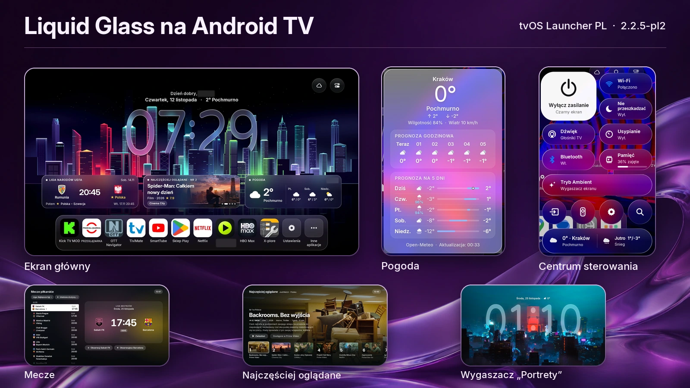

[Galeria sześciu widoków / Six-screen gallery](zrzuty-github/gotowe/preview.webp)

## Polski

Polska wersja [tvOS Launcher autorstwa techgenius1](https://github.com/techgenius1/tvOS-Launcher), oparta na wersji 2.2.5. Opis samego launchera i jego pozostałych funkcji znajdziesz w oryginalnym repozytorium; tutaj pokazujemy zmiany moda PL.

### Pobieranie

**[Pobierz najnowszy APK](https://github.com/premiumsmart/tvOS-Launcher-PL/releases/latest/download/tvOS-Launcher-PL.apk)** · Android TV / Google TV z Androidem 7.0 lub nowszym · [opis wydania i suma SHA-256](https://github.com/premiumsmart/tvOS-Launcher-PL/releases/latest)

### Nowe w 2.2.5-pl2

- **Okna widżetów w stylu tvOS 27**: „Najczęściej oglądane” i „Top filmy i seriale” z dużym kadrem na cały ekran i półką plakatów, mecze w kolorach drużyn, wiadomości w kolorze tapety, pogoda na przezroczystym szkle.
- **Zaznaczenie ikon w doku w stylu tvOS 27** (powiększenie, cień, jasna krawędź szkła, połysk za ruchem pilota) i opcja **Krawędź jasnych ikon**.
- **Centrum sterowania w układzie tvOS 27** (duży kafel zasilania, kapsuły, okrągłe przyciski, przezroczyste tło); dawny układ zostaje do wyboru w ustawieniach.
- **Szklany wskaźnik głośności** do wyboru w kreatorze albo w jednorazowym pytaniu po aktualizacji: pigułka w stylu tvOS przy prawej krawędzi zamiast paska Androida (przystawki z Androidem 10 lub nowszym, tryb stałego ADB).
- Listy ustawień i kreatora z białą pigułką zaznaczenia, słowa jak w tvOS (Centrum sterowania, Usypianie, Wyłącz zasilanie, Wł./Wył., „Czarny ekran”); kreator zaleca tryb stałego ADB.
- Nowy styl zegara wygaszacza **„Duży, w stylu »Portrety«”** z rozmiarem dobieranym do zdjęcia i lepsze wykrywanie aut (zegar nie staje na aucie widzianym z bliska).
- Poprawka błędu oryginału: kafelek zmienia się od razu po włączeniu albo wyłączeniu widżetu.

Wcześniej, w 2.2.5-pl: zmiany oryginału 2.2.5 po polsku (nowa wyszukiwarka, płynniejszy ekran główny, „Oglądaj dalej” z większej liczby aplikacji, wybór kraju wiadomości, menu zasilania Androida), klawisz Home zamyka okna kafelków moda, kafelki **Wiadomości na żywo** i **Top filmy i seriale** zamiast krykieta.

Wcześniej, w 2.2.0-pl: dok w 1–3 rzędach z dopasowanym rzędem kafelków, okno „Aplikacje”, mały zegar, przenoszenie i wyłączanie kafelków przytrzymaniem OK, styl cyfr zegara w wygaszaczu, aktualizacje prosto z tego repozytorium.

### Co zmieniono

| Zmiana | Ilustracja — kliknij, aby powiększyć |
| --- | --- |
| **Pełne spolszczenie.** Interfejs, kreator pierwszego uruchomienia i opisy pogody są po polsku. Zaznaczony wiersz list w ustawieniach to biała pigułka, jak w tvOS 27. | [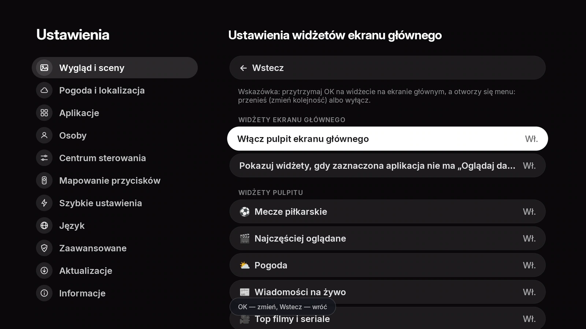](zrzuty-github/gotowe/widget-settings.webp) |
| **Kafelki i okna Liquid Glass: mecze.** Kafelek pokazuje najbliższy mecz, a podczas spotkania wynik na żywo z LiveScore; osobne okno w stylu tvOS 27 pozwala przeglądać mecze i obserwować drużyny. | [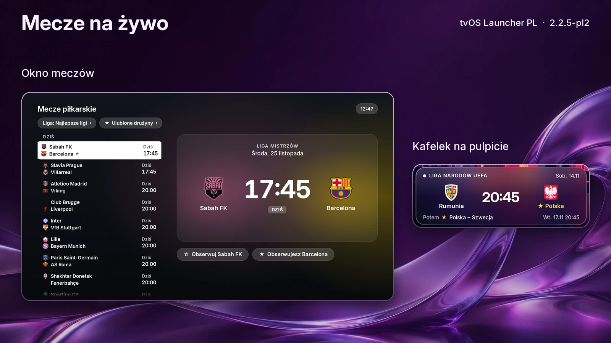](zrzuty-github/gotowe/prezentacja/matches.webp) Pełne kadry: [okno meczów](zrzuty-github/gotowe/matches.webp) · [kafelek](zrzuty-github/gotowe/matches-tile.webp) |
| **„Najczęściej oglądane” i „Top filmy i seriale”.** Szklane kafelki i okna z popularnymi filmami i serialami z JustWatch dla Polski oraz z rankingiem Cinemeta (dane IMDb): duży kadr, opis, przejście do dostępnych serwisów i półka plakatów. | [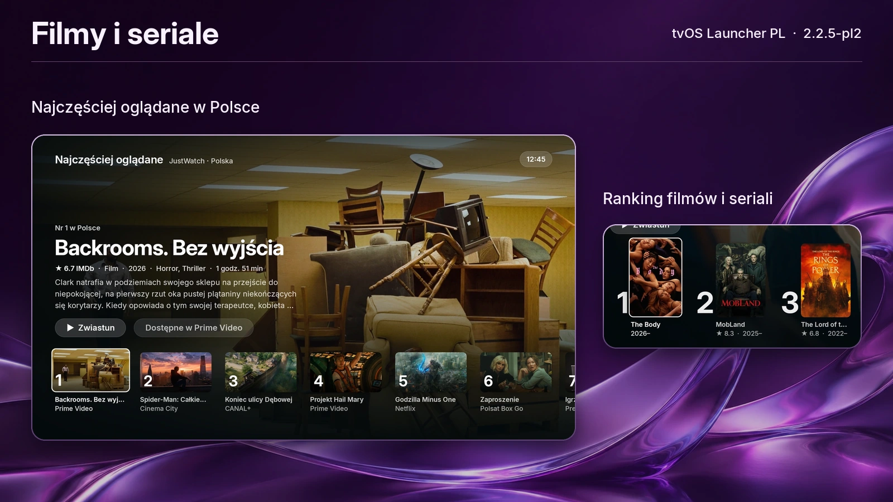](zrzuty-github/gotowe/prezentacja/cinema.webp) Pełne kadry: [Najczęściej oglądane](zrzuty-github/gotowe/most-watched.webp) · [Top filmy i seriale](zrzuty-github/gotowe/top-movies.webp) |
| **Pogoda.** Kafelek Liquid Glass otwiera polską prognozę godzinową i na kolejne dni na przezroczystym szkle. | [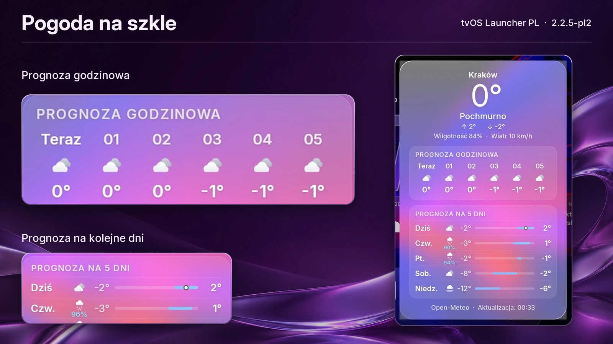](zrzuty-github/gotowe/prezentacja/weather.webp) Pełny kadr: [panel pogody](zrzuty-github/gotowe/weather.webp) |
| **Centrum sterowania i wskaźnik głośności.** Centrum sterowania w układzie tvOS 27: duży kafel zasilania, kapsuły, okrągłe przyciski i przezroczyste tło. Szklany wskaźnik głośności przy prawej krawędzi ekranu jest do wyboru na przystawkach z Androidem 10 lub nowszym, w trybie stałego ADB. | [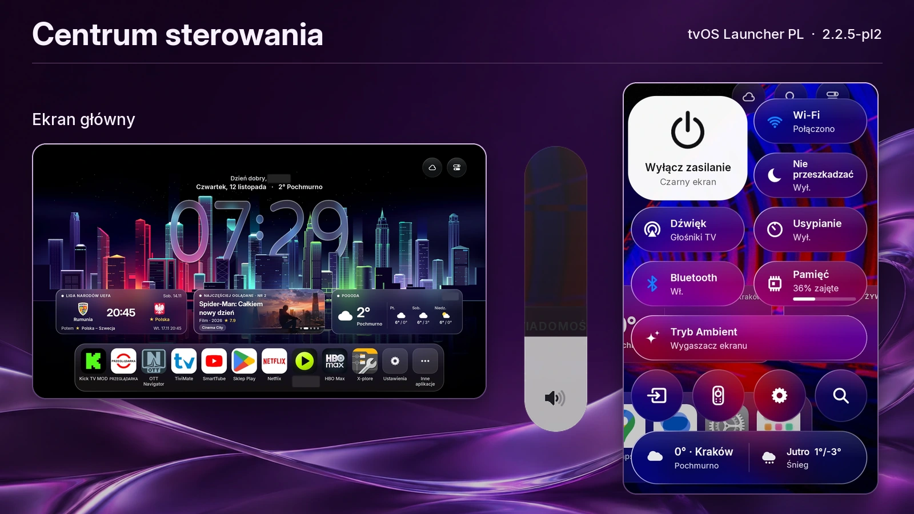](zrzuty-github/gotowe/prezentacja/controls.webp) Pełne kadry: [Centrum sterowania](zrzuty-github/gotowe/control-center.webp) · [wskaźnik głośności](zrzuty-github/gotowe/volume-pill.webp) · [detal wskaźnika](zrzuty-github/gotowe/volume-pill-detail.webp) |
| **Dok w stylu tvOS 27.** Zaznaczona ikona rośnie i dostaje miękki cień, jasną krawędź szkła oraz połysk, który przesuwa się za ruchem pilota. | [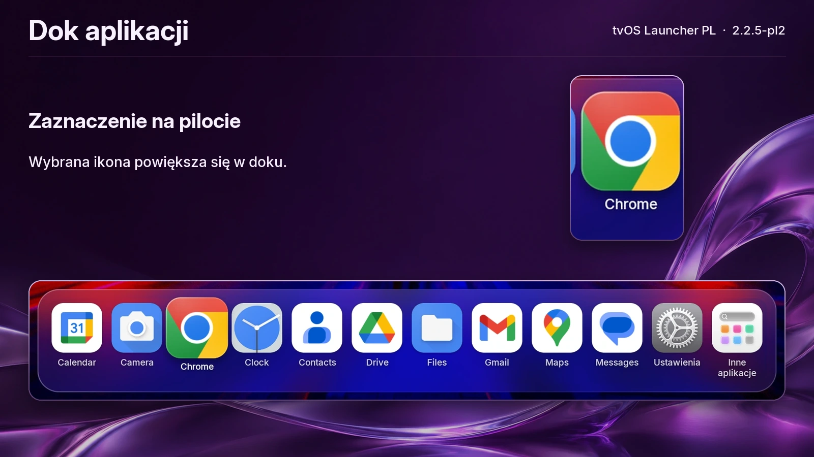](zrzuty-github/gotowe/prezentacja/dock.webp) Pełny kadr: [dok z zaznaczoną ikoną](zrzuty-github/gotowe/dock-focus.webp) |
| **Powiadomienia o golach.** Plakietki z herbami i wynikiem ulubionych drużyn mogą pojawiać się także nad innymi aplikacjami, po nadaniu zgody. Zrzut pokazuje powiadomienie przykładowe. | [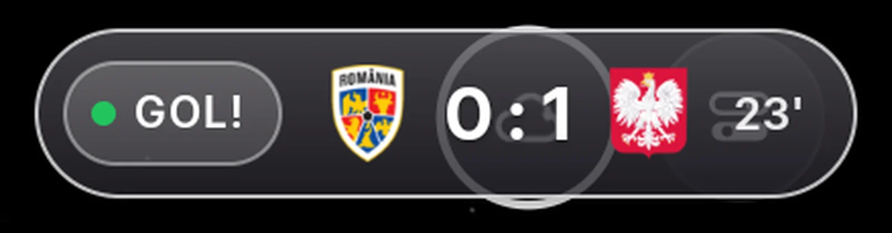](zrzuty-github/gotowe/goal-badge.webp) Pełny kadr: [powiadomienie na ekranie](zrzuty-github/gotowe/goal-notification.webp) |
| **„Oglądaj dalej” przez lokalne ADB.** Uprawnienie do informacji o odtwarzaniu można włączyć z launchera, potwierdzając zgodę na telewizorze. | Pełny kadr: [kreator, tryb nadawania uprawnień](zrzuty-github/gotowe/setup-mode.webp) |
| **Nocne tapety z internetu.** Supercary i auta po tuningu — m.in. Audi RS, Mercedes-AMG i Lamborghini — w nocy i neonach oraz futurystyczne miasta nocą; zdjęcia za dnia launcher pomija. Zapisane ulubione tapety wracają domyślnie co piątą zmianę; częstotliwość można zmienić. | [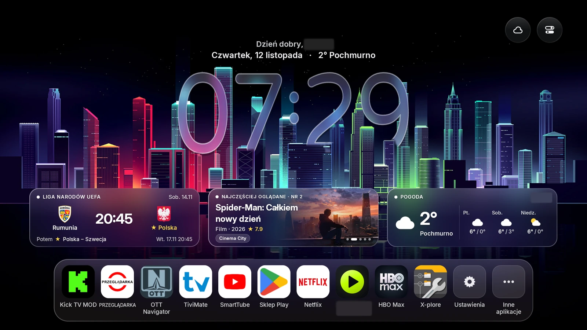](zrzuty-github/gotowe/home.webp) Pełny kadr: [ustawienia tapet z internetu](zrzuty-github/gotowe/wallpaper-settings.webp) |
| **Zegar dopasowany do zdjęcia.** Dół szklanych cyfr chowa się za dachem auta lub budynkami, a wykrywacz aut TensorFlow Lite działający w telewizorze pomaga unikać ustawiania zegara na aucie. Cyfry zachowują szklany wygląd scen oryginału. | [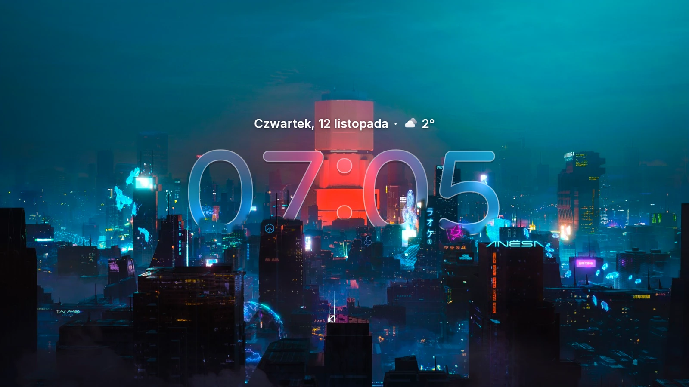](zrzuty-github/gotowe/screensaver-1.webp) |
| **Wygaszacz ekranu „Portrety”.** Wygaszacz korzysta z tych samych zdjęć i tego samego szklanego zegara co ekran główny, a styl cyfr można wybrać. Nowy styl „Duży, w stylu »Portrety«” ma duże cyfry z mlecznego szkła, których wielkość launcher dobiera do zdjęcia. | [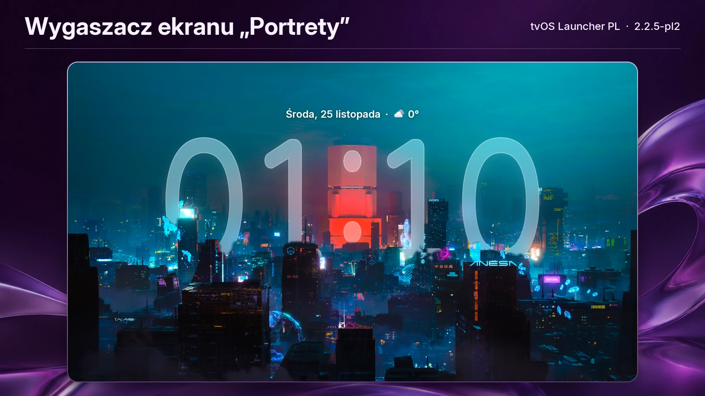](zrzuty-github/gotowe/prezentacja/portraits.webp) Pełne kadry: [wygaszacz „Portrety”](zrzuty-github/gotowe/screensaver-portraits.webp) · [ustawienia wygaszacza](zrzuty-github/gotowe/screensaver-settings.webp) |
| **Pierwsze uruchomienie.** Polski kreator zaleca tryb stałego ADB, który nie wyłącza debugowania USB: działają wtedy ostatnie aplikacje, aktualizacje przez ADB i wskaźnik głośności. Na przystawkach z Androidem 10 lub nowszym kreator pyta też, jaki wskaźnik głośności pokazywać. | [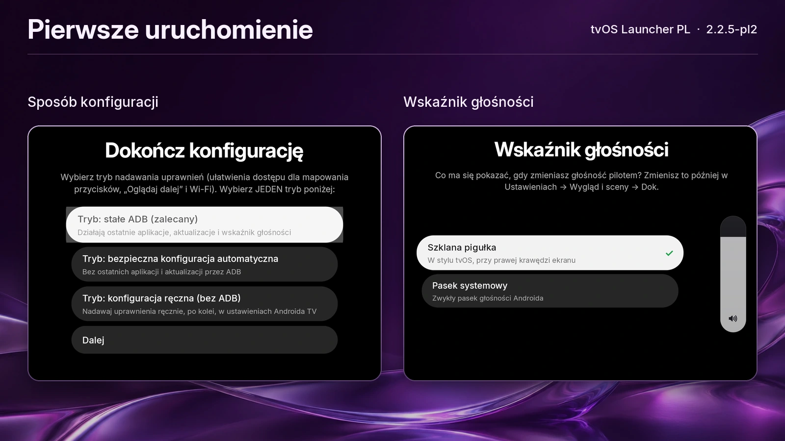](zrzuty-github/gotowe/prezentacja/setup.webp) Pełne kadry: [tryb konfiguracji](zrzuty-github/gotowe/setup-mode.webp) · [wskaźnik głośności](zrzuty-github/gotowe/setup-volume.webp) |
| **Aktualizacje z ustawień (od 2.2.0-pl).** Launcher sam sprawdza wydania tego repozytorium (**Ustawienia → Aktualizacje**, automatyczne sprawdzanie domyślnie włączone) i pokazuje okno z listą zmian i przyciskiem „Zainstaluj”; ustawienia zostają. Po aktualizacji do 2.2.5-pl2 kreator nie uruchamia się ponownie, a launcher raz pyta, czy włączyć szklany wskaźnik głośności (tylko tam, gdzie zadziała). Na zrzutach wersja testowa. | [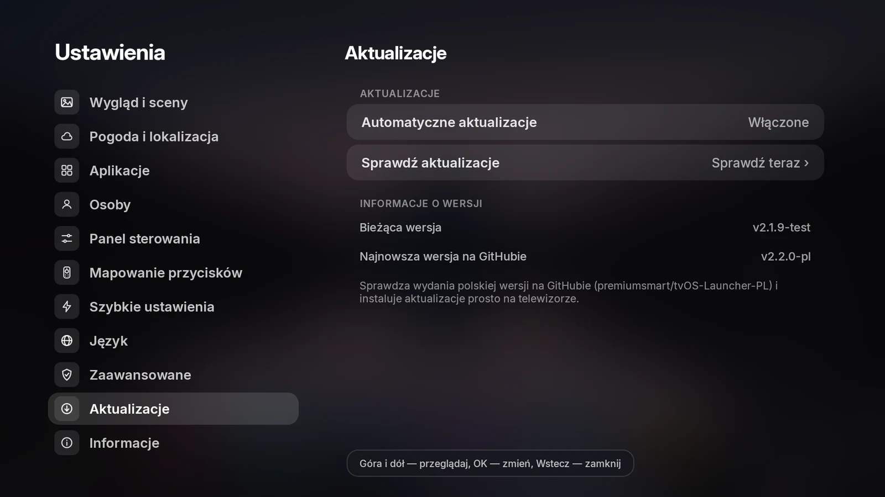](zrzuty-github/gotowe/update-settings.webp) [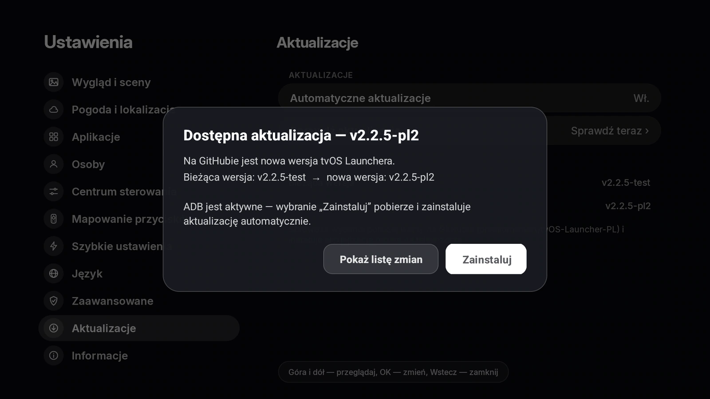](zrzuty-github/gotowe/update-dialog.webp) Pełny kadr: [pytanie po aktualizacji](zrzuty-github/gotowe/update-question.webp) |

### Instalacja i aktualizacje

1. Pobierz APK (link wyżej) i przenieś na Android TV / Google TV pendrive'em lub przez Send files to TV.
2. Otwórz plik w menedżerze plików; jeśli trzeba, zezwól temu menedżerowi na instalację z nieznanych źródeł.
3. Przejdź polski kreator: profil, sceny i miasto do pogody, a na przystawkach z Androidem 10 lub nowszym także wskaźnik głośności. Wybierz konfigurację ręczną, jeśli chcesz samodzielnie nadawać uprawnienia; wyłączanie systemowych launcherów i CleanYourTV są opcjonalne.
4. Jeśli system zapyta o domyślny ekran główny, wybierz tvOS Launcher; w przeciwnym razie uruchamiaj go z listy aplikacji.

**Aktualizacje:** launcher sam sprawdza wydania tego repozytorium i proponuje instalację nowej wersji (**Ustawienia → Aktualizacje**; automatyczne sprawdzanie jest domyślnie włączone). Ustawienia zostają, a kreator nie uruchamia się ponownie; po aktualizacji do 2.2.5-pl2 launcher raz zapyta o szklany wskaźnik głośności (tylko tam, gdzie zadziała). Wersja 2.1.5-pl30 sprawdzała jeszcze oryginał, więc z niej zainstaluj nową wersję raz ręcznie, na poprzednią.

**„Oglądaj dalej”:** włącz debugowanie USB w opcjach programisty telewizora, następnie **Ustawienia launchera → Szybkie ustawienia → Uprawnienie „Oglądaj dalej” → Włącz** i potwierdź pytanie telewizora. Po nadaniu uprawnienia możesz wyłączyć debugowanie USB.

### Dane i licencja

Mecze: [LiveScore](https://www.livescore.com/), pomocniczo [ESPN](https://www.espn.com/) i [TheSportsDB](https://www.thesportsdb.com/); wiadomości: [Google News](https://news.google.com/); popularne tytuły: [JustWatch Polska](https://www.justwatch.com/pl); ranking „Top filmy i seriale”: Cinemeta ([Stremio](https://www.stremio.com/), dane IMDb); pogoda: [Open-Meteo](https://open-meteo.com/); tapety: [Wallhaven](https://wallhaven.cc/), [Wikimedia Commons](https://commons.wikimedia.org/) i [Bing](https://www.bing.com/).

Kod: [Apache-2.0](LICENSE); informacje o autorstwie i bibliotekach: [NOTICE](NOTICE). Dołączono TensorFlow Lite 2.14.0 i model SSD MobileNet v1 COCO od Google, na licencji Apache-2.0. Lista zmian: [RELEASE_NOTES.md](RELEASE_NOTES.md).

Projekt nie jest powiązany z Apple, LiveScore, ESPN, JustWatch, Google, Stremio, IMDb, Open-Meteo, Wallhaven, Wikimedia ani Microsoft (Bing). Zdjęcia i dane należą do ich właścicieli, a aplikacja pobiera je z odpowiednich serwisów; licencja kodu nie obejmuje tych materiałów.

---

## English

A Polish version of [tvOS Launcher by techgenius1](https://github.com/techgenius1/tvOS-Launcher), based on version 2.2.5. See the original repository for the launcher itself and its other features; this page covers the PL mod changes.

### Download

**[Download the latest APK](https://github.com/premiumsmart/tvOS-Launcher-PL/releases/latest/download/tvOS-Launcher-PL.apk)** · Android TV / Google TV running Android 7.0 or later · [release notes and SHA-256 checksum](https://github.com/premiumsmart/tvOS-Launcher-PL/releases/latest)

### New in 2.2.5-pl2

- **Widget windows in a tvOS 27 style**: “Most Watched” and “Top movies and series” with a full-screen backdrop and a poster shelf, football in the teams’ colours, news tinted by the wallpaper, weather on clear glass.
- **tvOS 27-style dock icon focus** (scale, shadow, bright glass edge, a sheen that follows the remote) and an **Edge of bright icons** option.
- **Control Center in a tvOS 27 layout** (large power tile, capsules, round buttons, clear background); the old grid remains available in settings.
- **Glass volume indicator**, chosen in the setup wizard or in a one-time question after updating: a tvOS-style pill at the right edge instead of Android’s volume bar (set-top boxes with Android 10 or later in persistent ADB mode).
- Settings and wizard lists with a white focus pill, tvOS wording in Polish, and the wizard now recommends persistent ADB mode.
- A new screensaver clock style, **“Large, Portraits style”**, sized to each photo, and better car detection (the clock no longer lands on cars seen up close).
- A fix for a bug in the original: tiles change right after a widget is turned on or off.

Earlier, in 2.2.5-pl: the original 2.2.5 changes in Polish (new search, smoother home screen, Continue Watching from more apps, news country setting, Android power menu), the Home key closes the mod’s tile windows, **Live news** and **Top movies and series** tiles instead of cricket.

Earlier, in 2.2.0-pl: 1–3 dock rows with a matching tile row, the “Apps” window, a small clock, moving and hiding tiles with a long OK press, a selectable screensaver clock style, updates straight from this repository.

### Changes

| Change | Illustration — click to enlarge |
| --- | --- |
| **Full Polish translation.** The interface, first-run wizard and weather descriptions are in Polish. The focused row in settings lists is a white pill, as in tvOS 27. |  |
| **Liquid Glass tiles and windows: football.** The tile shows the next fixture and LiveScore scores during a match; a dedicated tvOS 27-style window lets you browse fixtures and follow teams. |  Full frames: [fixture window](zrzuty-github/gotowe/matches.webp) · [tile](zrzuty-github/gotowe/matches-tile.webp) |
| **“Most Watched” and “Top movies and series”.** Glass tiles and windows with popular films and series from JustWatch for Poland and the Cinemeta ranking (IMDb data): a large backdrop, a description, links to available services and a poster shelf. |  Full frames: [Most Watched](zrzuty-github/gotowe/most-watched.webp) · [Top movies and series](zrzuty-github/gotowe/top-movies.webp) |
| **Weather.** The Liquid Glass tile opens an hourly and multi-day forecast in Polish on clear glass. |  Full frame: [weather panel](zrzuty-github/gotowe/weather.webp) |
| **Control Center and volume indicator.** A tvOS 27 Control Center layout: a large power tile, capsules, round buttons and a clear background. A glass volume indicator at the right edge of the screen is optional on set-top boxes with Android 10 or later in persistent ADB mode. |  Full frames: [Control Center](zrzuty-github/gotowe/control-center.webp) · [volume indicator](zrzuty-github/gotowe/volume-pill.webp) · [indicator detail](zrzuty-github/gotowe/volume-pill-detail.webp) |
| **tvOS 27-style dock.** The focused icon grows and gets a soft shadow, a bright glass edge and a sheen that follows the remote. |  Full frame: [dock with a focused icon](zrzuty-github/gotowe/dock-focus.webp) |
| **Goal notifications.** Badges with favorite teams’ crests and scores can appear over other apps after permission is granted. The screenshot shows a sample notification. |  Full frame: [notification on screen](zrzuty-github/gotowe/goal-notification.webp) |
| **Continue Watching through local ADB.** Playback-information access can be enabled from the launcher by confirming a prompt on the TV. | Full frame: [wizard, permission mode](zrzuty-github/gotowe/setup-mode.webp) |
| **Nighttime internet wallpapers.** Supercars and tuned cars — including Audi RS, Mercedes-AMG and Lamborghini — at night and in neon light, plus futuristic cities at night; the launcher skips daytime images. Saved favorites return every fifth wallpaper change by default; the frequency is configurable. |  Full frame: [internet wallpaper settings](zrzuty-github/gotowe/wallpaper-settings.webp) |
| **A clock that fits the image.** The bottom of the glass digits hides behind car roofs or buildings, while an on-device TensorFlow Lite car detector helps keep the clock off the car itself. The digits retain the original scenes’ glass appearance. |  |
| **“Portraits” screensaver.** The screensaver uses the same images and glass clock as the home screen, and the digit style is selectable. The new “Large, Portraits style” has large frosted-glass digits sized to each photo. |  Full frames: [“Portraits” screensaver](zrzuty-github/gotowe/screensaver-portraits.webp) · [screensaver settings](zrzuty-github/gotowe/screensaver-settings.webp) |
| **First run.** The Polish wizard recommends persistent ADB mode, which keeps USB debugging on, so recent apps, ADB updates and the volume indicator work. On set-top boxes with Android 10 or later the wizard also asks which volume indicator to show. |  Full frames: [setup mode](zrzuty-github/gotowe/setup-mode.webp) · [volume indicator](zrzuty-github/gotowe/setup-volume.webp) |
| **Updates from settings (since 2.2.0-pl).** The launcher checks this repository’s releases (**Settings → Updates**, automatic checks on by default) and shows a window with the changelog and an “Install” button; your settings are kept. After updating to 2.2.5-pl2 the wizard does not run again; the launcher asks once whether to turn on the glass volume indicator (only where it works). The screenshots show a test build. |   Full frame: [question after updating](zrzuty-github/gotowe/update-question.webp) |

### Installation and updates

1. Download the APK (link above) and transfer it to Android TV / Google TV using a USB drive or Send files to TV.
2. Open it in a file manager; allow that file manager to install unknown apps if prompted.
3. Complete the Polish wizard: profile, scenes and weather location, plus the volume indicator on set-top boxes with Android 10 or later. Choose manual setup if you prefer to grant permissions yourself; disabling system launchers and using CleanYourTV are optional.
4. Select tvOS Launcher if Android asks for a default home app; otherwise launch it from the app list.

**Updates:** the launcher checks this repository’s releases and offers to install new versions (**Settings → Updates**; automatic checks are on by default). Your settings are kept and the wizard does not run again; after updating to 2.2.5-pl2 the launcher asks once about the glass volume indicator (only where it works). Version 2.1.5-pl30 still checked the original repository, so install the new version over it manually once.

**Continue Watching:** enable USB debugging in the TV’s developer options, then go to **Launcher settings → Quick settings → “Continue Watching” permission → Enable** and confirm the TV prompt. You may disable USB debugging afterwards.

### Data and license

Football: [LiveScore](https://www.livescore.com/) with supplementary [ESPN](https://www.espn.com/) and [TheSportsDB](https://www.thesportsdb.com/) data; news: [Google News](https://news.google.com/); popular titles: [JustWatch Poland](https://www.justwatch.com/pl); “Top movies and series”: Cinemeta ([Stremio](https://www.stremio.com/), IMDb data); weather: [Open-Meteo](https://open-meteo.com/); wallpapers: [Wallhaven](https://wallhaven.cc/), [Wikimedia Commons](https://commons.wikimedia.org/) and [Bing](https://www.bing.com/).

Code: [Apache-2.0](LICENSE); credits and dependencies: [NOTICE](NOTICE). Includes TensorFlow Lite 2.14.0 and Google’s SSD MobileNet v1 COCO model under Apache-2.0. Changelog: [RELEASE_NOTES.md](RELEASE_NOTES.md).

This project is not affiliated with Apple, LiveScore, ESPN, JustWatch, Google, Stremio, IMDb, Open-Meteo, Wallhaven, Wikimedia or Microsoft (Bing). Images and data belong to their respective owners and are fetched from their services; the code license does not cover those materials.
